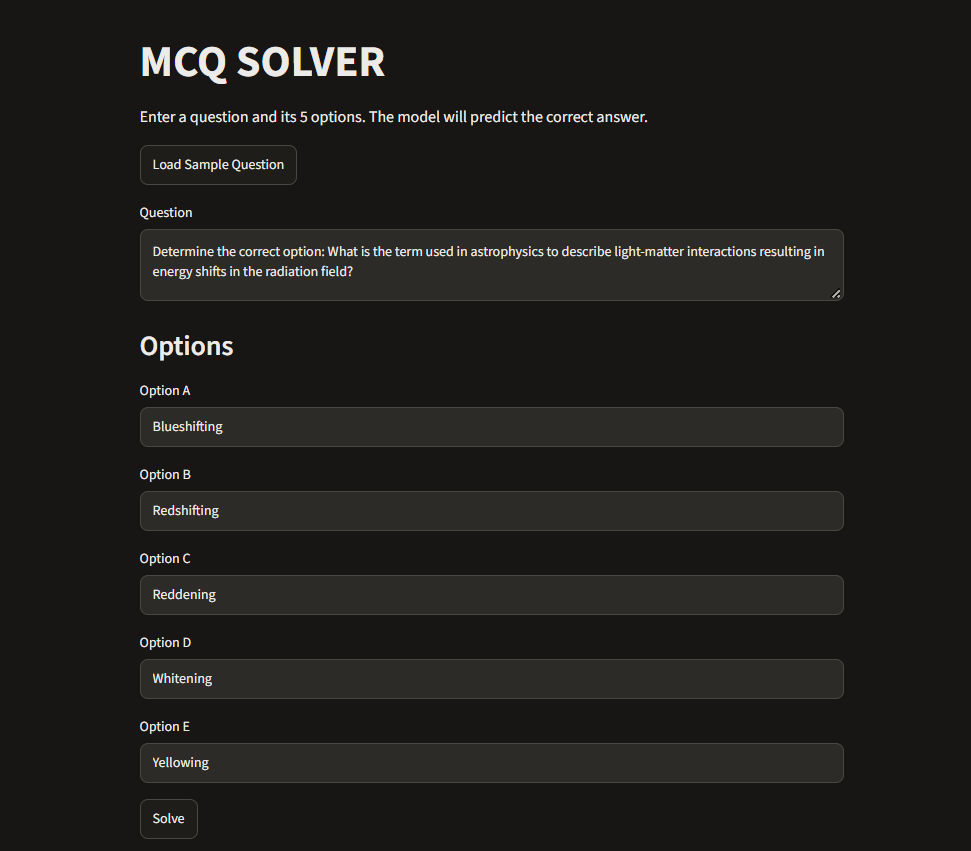
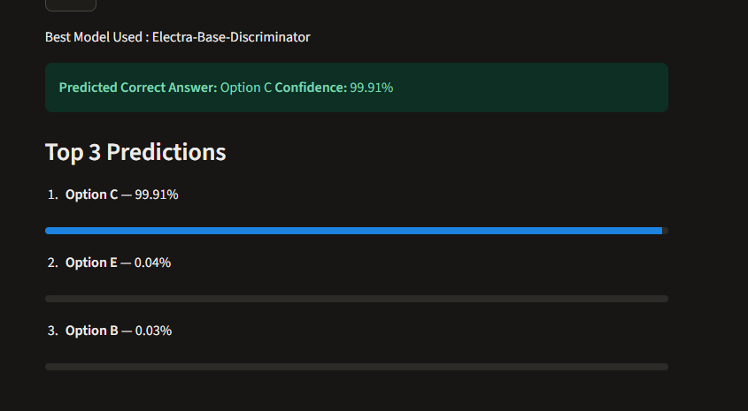

# 🧠 MCQ Solver: Multiple-Choice Question Answering with Transformers

Fine-tuned **ELECTRA** and **RoBERTa** to pick the correct answer from five options (A–E), compared against classical and neural baselines, and deployed as an interactive **Streamlit** app.

[](http://mcq-transformers-solver.streamlit.app/)
[](https://huggingface.co/24f2002314/electra-mcq-solver)


## 🖥️ Demo





---

## 📌 Overview

Given a question and five candidate answers, the model predicts which option is correct and returns its top-3 predictions with confidence scores. The questions are mostly science-focused (physics and biology dominate), and performance is measured with **MAP@3** and **accuracy**.

🏆 **Best leaderboard score: MAP@3 = 0.76101** (ELECTRA + RoBERTa ensemble).

The project follows a progression from simple heuristics to fine-tuned transformers, so each step shows what the extra complexity buys.

## 🔬 Approach

1. **EDA**: answer-class balance (slightly biased towards B), length-bias check, length distributions to choose the tokenizer `max_length`, and word clouds.
2. **Feature engineering**: prompt/option lengths, word overlap, "none/all of the above" flags and length ranks.
3. **Baselines**
   - Longest-option heuristic
   - TF-IDF prompt–option similarity
   - Word2Vec cosine similarity
   - Custom feed-forward ANN (`MCQANN`) on the engineered features
4. **Transformer fine-tuning** (`AutoModelForMultipleChoice`) on an augmented training set (options shuffled and relabelled):
   - `google/electra-base-discriminator`: lr 4e-5, 6 epochs
   - `roberta-base`: lr 3e-5, 5 epochs
5. **Ensemble**: weighted average of the softmaxed logits (**0.8 ELECTRA + 0.2 RoBERTa**) for the final test predictions.
6. **Experiment tracking** with Weights & Biases, and **deployment** with Streamlit.

## 📊 Results

**Leaderboard (held-out test set): MAP@3 = 0.76101** with the 0.8 ELECTRA + 0.2 RoBERTa ensemble.

Local validation results (80/20 split):

| Model | Val MAP@3 | Val Accuracy |
|---|---|---|
| Longest-option heuristic | 0.497 | 0.383 |
| TF-IDF similarity | 0.532 | 0.353 |
| Word2Vec similarity | 0.374 | 0.210 |
| Custom ANN | 0.916 | 0.868 |
| RoBERTa-base | 0.433 | 0.433 |
| **ELECTRA-base** | **1.000** | **1.000** |

> ⚠️ **Note:** the ELECTRA validation score is likely inflated because the augmented training set contains duplicated prompts. The held-out leaderboard score (**0.76101 MAP@3**) is the more reliable figure.

## 🗂️ Project Structure

```
├── app.py                         # Streamlit inference app
├── requirements.txt
├── training.ipynb                 # Main notebook: EDA → baselines → fine-tuning → ensemble
├── milestones/                    # Course milestone notebooks (1–5)
└── models/                        # Saved checkpoints (see note below)
```

## 🚀 Run Locally

```bash
git clone https://github.com/<your-username>/<repo-name>.git
cd <repo-name>
pip install -r requirements.txt
streamlit run app.py
```

The app downloads the fine-tuned model from Hugging Face on first run, so the first launch takes a moment.

## 🖥️ Using the App

1. Enter a question and five options (or click **Load Sample Question**).
2. Click **Solve**.
3. Get the predicted answer, its confidence, and the top-3 predictions.

## 🛠️ Tech Stack

Python · PyTorch · Hugging Face Transformers · scikit-learn · Gensim (Word2Vec) · Pandas / NumPy / Matplotlib · Weights & Biases · Streamlit

## 📚 Context

Built as the Deep Learning & Generative AI project for the **IIT Madras BS in Data Science** program.

## 👤 Author

**Sai Chaithanyia**
[GitHub](https://github.com/<your-username>) · [LinkedIn](https://linkedin.com/in/<your-handle>)

---